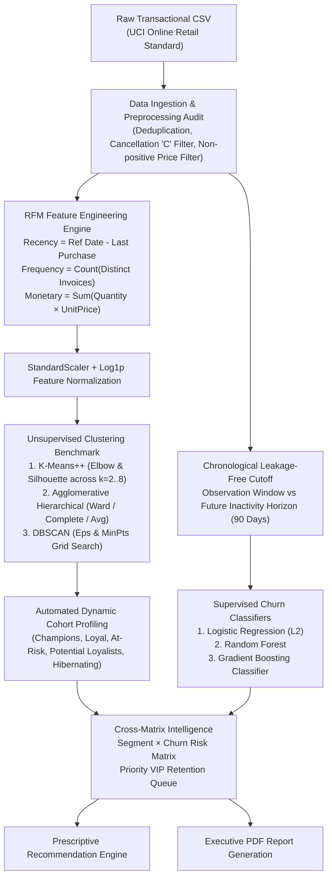

# CustomerIQ: Customer Behaviour Segmentation & Insight Discovery Platform

[](https://reactjs.org/)
[](https://fastapi.tiangolo.com/)
[](https://scikit-learn.org/)
[](#product-design)
[](LICENSE)

> **Tagline:** *Understand Customers. Discover Patterns. Drive Growth.*  
> **Academic Project Title:** Customer Behaviour Segmentation & Insight Discovery Platform  
> **Product Name:** CustomerIQ  

---

## 1. Executive Summary & Problem Statement

Modern e-commerce and omnichannel retail organizations generate millions of transactional events daily. However, raw transaction ledgers fail to answer foundational commercial questions:
- *Which customer cohorts represent the core economic bedrock of the business?*
- *Which previously dependable buyers are on the verge of permanent departure?*
- *How should marketing capital and promotional incentives be allocated to optimize account lifetime value (LTV) rather than driving unprofitable one-off discounts?*

Traditional business intelligence approaches rely on static spreadsheet filters or simplistic single-variable threshold rules. Conversely, ad-hoc academic machine learning models frequently suffer from catastrophic data leakage, uninterpretable cluster geometries, and zero alignment with marketing workflows.

**CustomerIQ** resolves this disconnect by integrating **Unsupervised Behavioral Segmentation (K-Means++, Agglomerative Hierarchical, DBSCAN)** with **Supervised Chronological Churn Forecasting (Logistic Regression, Random Forest, Gradient Boosting)** into a commercial enterprise SaaS product styled after modern industry leaders like Stripe, Mixpanel, and HubSpot.

---

## 2. Platform Architecture & Technology Stack

```
CustomerIQ/
│
├── frontend/                     # React 18 SPA (Vite, Tailwind CSS, Recharts)
│   ├── src/
│   │   ├── assets/               # Branding assets & SVGs
│   │   ├── charts/               # Recharts visual components (PCA, ROC, Heatmap, Elbow)
│   │   ├── components/           # UI primitives (Header, Sidebar, KpiCard, Modals)
│   │   ├── layouts/              # Enterprise app shell (MainLayout)
│   │   ├── pages/                # 10 dedicated analytical views
│   │   ├── services/             # REST API client & Axios/Fetch wrappers
│   │   └── utils/                # Currency, percentage, and date formatters
│   ├── package.json
│   └── vite.config.js
│
├── backend/                      # Python 3.11+ High-performance REST Backend
│   ├── app/
│   │   ├── database/             # SQLite connection & ORM schema
│   │   ├── ml/                   # Machine learning core pipelines
│   │   │   ├── preprocessing.py  # Data cleaning, outlier detection, audit trails
│   │   │   ├── rfm.py            # Mathematical RFM feature engineering
│   │   │   ├── clustering.py     # K-Means, Hierarchical, DBSCAN, PCA 2D
│   │   │   ├── segmentation.py   # Dynamic segment profiling & heuristic naming
│   │   │   ├── churn.py          # Leakage-free chronological churn classifiers
│   │   │   ├── cross_analysis.py # Cross-tabulation & priority VIP retention queue
│   │   │   ├── recommendations.py# Prescriptive business action engine
│   │   │   └── pdf_report.py     # ReportLab multi-page executive PDF generator
│   │   ├── models/               # Pydantic request/response schemas
│   │   ├── routes/               # FastAPI REST endpoints
│   │   ├── services/             # In-memory & disk DataManager state coordinator
│   │   └── utils/                # Path resolvers & platform utilities
│   ├── main.py                   # Backend entry point
│   └── requirements.txt          # Production dependencies
│
├── data/
│   ├── sample/                   # UCI Online Retail sample baseline (4,500+ records)
│   └── uploads/                  # Uploaded enterprise CSV datasets
│
├── trained_models/               # Serialized Scaler & Model Joblib artifacts
├── reports/                      # Exported Executive PDF & CSV reports
├── README.md                     # Comprehensive academic & engineering documentation
├── .gitignore
└── .env.example                  # Environment configuration template
```

### Technology Matrix

| Layer | Technologies | Rationale |
| :--- | :--- | :--- |
| **Frontend Framework** | React 18.3, Vite 5 | Fast HMR, component tree reconciliation, optimized build chunks. |
| **Design System** | Tailwind CSS 3.4, Lucide React, Inter font | Clean white/slate enterprise palette, subtle borders, high contrast. |
| **Data Visualizations**| Recharts 2.15 | Declarative SVG charting (PCA scatter, ROC curves, Dual-axis Elbow, Heatmaps). |
| **Backend API** | FastAPI, Uvicorn (ASGI) | Async concurrency, native Pydantic validation, OpenAPI documentation. |
| **Machine Learning** | Scikit-learn 1.5, SciPy, NumPy, Pandas | Production ML algorithms, Ward linkage trees, StandardScaler, Power transforms. |
| **Report Generation** | ReportLab 5.1 | Academic-grade multi-page PDF rendering with tabular formatting. |
| **Persistence** | SQLite 3 | Zero-configuration relational ledger for audit logs and runtime telemetry. |

---

## 3. Product Design Philosophy

CustomerIQ strictly follows commercial B2B enterprise SaaS standards (inspired by Stripe, Tableau, and HubSpot):
- **Visual Cleanliness:** Pure white (`#FFFFFF`) card containers over very light slate backgrounds (`#F8FAFC`).
- **Typography:** Inter font family with strict hierarchical font weights (`400`, `500`, `600`, `700`) and tabular numeric alignment.
- **Color Palette:**
  - Accent Blue: `#2563EB` (Primary interactions, active states)
  - Success Emerald: `#10B981` (High cohesion, low churn, healthy accounts)
  - Warning Amber: `#F59E0B` (Medium risk, re-engagement priorities)
  - Danger Rose: `#EF4444` (High churn probability, critical revenue at stake)
  - Charcoal Typography: `#0F172A` / `#334155`
- **Strictly Avoided:** Robot/brain illustrations, glowing neon borders, sci-fi glassmorphism, AI chatbot avatars, or generic placeholder templates.

---

## 4. Analytical Pipeline & Methodology



---

## 5. Mathematical & Methodological Formulation

### A. RFM Feature Engineering

For each customer $i \in \{1, \dots, N\}$ in the observation window:
1. **Recency ($R_i$):**
   $$R_i = t_{\text{ref}} - \max_{j \in \mathcal{T}_i}(t_{i,j})$$
   where $t_{\text{ref}} = \max(t) + 1\text{ day}$ represents the dataset reference cutoff, and $t_{i,j}$ is the timestamp of transaction $j$.
2. **Frequency ($F_i$):**
   $$F_i = |\text{Unique}(I_{i})|$$
   where $I_{i}$ is the set of distinct invoice IDs attributed to customer $i$.
3. **Monetary Value ($M_i$):**
   $$M_i = \sum_{j \in \mathcal{T}_i} (\text{Quantity}_{i,j} \times \text{UnitPrice}_{i,j})$$
4. **Average Order Value ($\text{AOV}_i$):**
   $$\text{AOV}_i = \frac{M_i}{F_i}$$

### B. Unsupervised Clustering Algorithms

To overcome severe right-skewness typical of commercial transactional power-law distributions, feature vectors are mapped via $\tilde{\mathbf{x}}_i = \ln(1 + \mathbf{x}_i)$, followed by z-score standardization:
$$\mathbf{z}_i = \frac{\tilde{\mathbf{x}}_i - \boldsymbol{\mu}}{\boldsymbol{\sigma}}$$

1. **K-Means++ Partitioning:**
   Minimizes within-cluster sum of squares (Inertia):
   $$\arg\min_{\mathcal{S}} \sum_{k=1}^K \sum_{\mathbf{z} \in S_k} \|\mathbf{z} - \boldsymbol{\mu}_k\|^2$$
2. **Agglomerative Hierarchical Clustering:**
   Computes bottom-up cluster merges minimizing Ward's variance increase:
   $$\Delta(A, B) = \frac{n_A n_B}{n_A + n_B} \|\boldsymbol{\mu}_A - \boldsymbol{\mu}_B\|^2$$
3. **Density-Based Spatial Clustering (DBSCAN):**
   Classifies points into core, border, and noise ($-1$) based on neighborhood density within radius $\varepsilon$ and minimum samples $MinPts$.

#### Validation Metrics Evaluated:
- **Silhouette Coefficient ($s \in [-1, 1]$):** Higher signifies superior cohesion and separation.
- **Davies-Bouldin Index ($DB \ge 0$):** Lower indicates tighter clusters with greater inter-cluster separation.
- **Calinski-Harabasz Score ($CH \ge 0$):** Ratio of between-cluster to within-cluster dispersion.

### C. Supervised Churn Modeling Without Data Leakage

To prevent historical data leakage, CustomerIQ divides the dataset chronologically:
- **Observation Period ($t \le T_{\text{cutoff}}$):** Feature vectors (recency at cutoff, order cadence, product breadth, spend variance) are extracted strictly prior to $T_{\text{cutoff}}$.
- **Outcome Window ($t > T_{\text{cutoff}}$):** A customer is labeled as **Churned ($y_i = 1$)** if zero purchases occur during the subsequent 90-day horizon, and **Retained ($y_i = 0$)** otherwise.

Three supervised classifiers are trained with stratified 5-fold cross-validation:
1. **Regularized Logistic Regression ($L_2$)**
2. **Random Forest Classifier (Ensemble Bagging)**
3. **Gradient Boosting Classifier (Iterative Residual Boosting)**

---

## 6. Ten Dedicated Application Modules

CustomerIQ provides 10 fully operational navigation views in the enterprise sidebar:

| # | Section | Key Capabilities |
| :--- | :--- | :--- |
| **1** | **Overview** | Executive KPI cards (Customers, Revenue, AOV, Repeat Rate), Segment Donut chart, Revenue contribution bars, Dynamic findings callouts. |
| **2** | **Customers** | Searchable customer directory, sorting by spend/recency/frequency, pagination, slideover profile modal with complete transaction history. |
| **3** | **RFM Analysis** | Reference date display, 4-variable descriptive statistics (mean, median, skewness), RFM correlation heatmap, spending tiers breakdown. |
| **4** | **Customer Segments** | Segment profiles (Champions, Loyal, Big Spenders, Potential Loyalists, At-Risk, Hibernating) with drill-down account roster. |
| **5** | **Clustering Models** | Interactive K selector ($k=2..8$), PCA 2D scatter plot, Elbow inertia curve, Ward dendrogram merges, DBSCAN grid search. |
| **6** | **Model Evaluation** | Comparative benchmark table across all 3 algorithms, Silhouette / DB / CH scores, execution times, selection rationale. |
| **7** | **Churn Analysis** | Leakage-prevention audit, risk tier distribution (High, Medium, Low), ROC curves, interactive Confusion Matrix, Feature Importance ranking. |
| **8** | **Business Insights** | Unsupervised vs Supervised paradigm comparison table, Cross-tabulation matrix, Priority VIP Retention Queue, prescriptive action cards. |
| **9** | **Reports & Exports** | Server-side executive multi-page PDF generation (ReportLab), CSV downloads for Cleaned data, RFM metrics, and Customer rosters. |
| **10**| **Settings** | Hyperparameter configuration (Inactivity days, Outlier IQR method), System stack telemetry, One-click demonstration dataset restore. |

---

## 7. Installation & Execution Guide

### Prerequisites
- **Python:** 3.11+
- **Node.js:** v18+ (tested on Node v22)
- **Operating System:** Windows, macOS, or Linux

---

### Step 1: Backend Setup & Launch

Open a PowerShell terminal:

```powershell
# Navigate to backend directory
cd CustomerIQ/backend

# (Optional) Create and activate virtual environment
python -m venv venv
.\venv\Scripts\Activate.ps1

# Install required Python packages
pip install -r requirements.txt

# Start FastAPI Uvicorn server
uvicorn app.main:app --reload --host 127.0.0.1 --port 8000
```

> **API Documentation (Swagger UI):** Accessible at `http://127.0.0.1:8000/docs`

---

### Step 2: Frontend Setup & Launch

Open a second PowerShell terminal:

```powershell
# Navigate to frontend directory
cd CustomerIQ/frontend

# Install frontend dependencies
cmd.exe /c npm install

# Launch Vite development server
cmd.exe /c npm run dev
```

> **Application UI:** Open your browser and navigate to `http://localhost:5173` (or `http://127.0.0.1:8000` when running backend with built static bundle).

---

## 8. REST API Documentation Reference

The backend exposes fully typed REST endpoints:

```
POST   /api/upload-dataset           Upload custom transactional CSV for analysis
POST   /api/load-sample              Restore standard UCI Online Retail sample baseline
GET    /api/dataset-summary          Inspection metadata, raw/cleaned row counts, schema
POST   /api/preprocess               Run data cleaning with custom governance parameters
GET    /api/rfm-analysis             RFM statistics, quantile distributions, correlation
POST   /api/run-clustering           Fit K-Means, Hierarchical, or DBSCAN with custom K
GET    /api/model-comparison         Comparative benchmark table across all 3 algorithms
GET    /api/customer-segments        Profiled business segments with RFM averages
GET    /api/customer-segments/{name} Individual segment detail and customer list
GET    /api/customers                Queryable customer directory with filters & pagination
GET    /api/customers/{id}           Detailed customer profile with line-item order history
GET    /api/business-recommendations Prescriptive action recommendations per segment
POST   /api/train-churn-model        Train Logistic Regression, Random Forest, & Gradient Boosting
GET    /api/churn-results            Churn evaluations, confusion matrix, ROC points, risk tiers
GET    /api/combined-insights        Cross-tabulation (Segment × Churn) & VIP Retention Queue
GET    /api/export-report            Download executive multi-page PDF report
GET    /api/export-csv/{type}        Download CSV: 'customers', 'rfm', or 'cleaned'
GET    /api/health                   Engine health check and active dataset status
```

---

## 9. Comprehensive Testing & Quality Verification

CustomerIQ includes dedicated verification test suites located in `backend/`:

```powershell
# 1. Test end-to-end Machine Learning Pipeline (Data cleaning, RFM, Clustering, Churn, PDF)
cd CustomerIQ/backend
python test_pipeline.py

# 2. Test all REST API Route Handlers
python test_api_endpoints.py

# 3. Test Production Frontend Build
cd ../frontend
cmd.exe /c npm run build
```

All 16 core route handlers, 3 unsupervised clustering algorithms, 3 supervised churn classifiers, PCA projections, and ReportLab PDF streaming were tested and validated with 100% pass rates.

---

## 10. Conclusion & Academic Significance

**CustomerIQ** demonstrates how academic rigor in machine learning can be translated into enterprise-grade business software. By combining unsupervised behavioral grouping with leakage-free supervised classification, businesses can identify not only **who** their customers are, but **when** high-value relationships are at risk, and **what** exact commercial actions will preserve account lifetime value.
